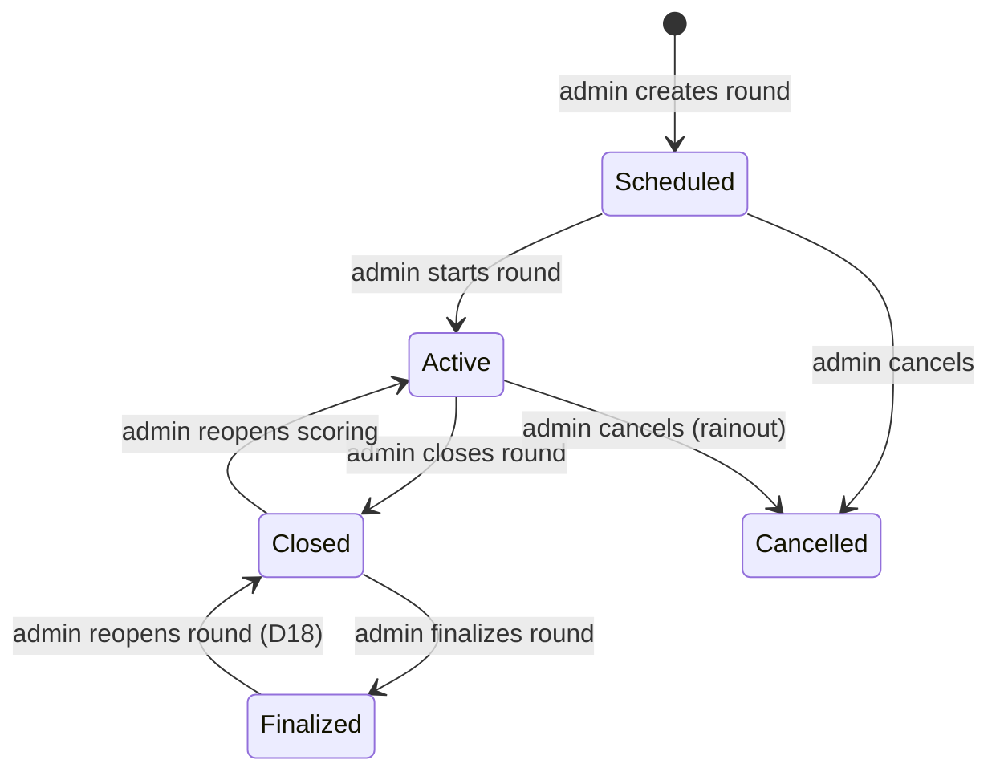

# AG Golf League Management Software — Design Document

## 1. Overview
This golf league management software will manage a public 9-hole golf league. The league plays at an 18-hole course. Each group plays either the front nine (holes 1–9) or the back nine (holes 10–18), and alternates between them week to week.

### 1.1 Scope and phases
- **Phase 1:** Build data models for leagues, courses, holes, players, groups, rounds, scores, games, settings
     - A new league record is created each year the league is run
     - Courses and holes remain and link to the current league record
     - Players are linked to the current league record.  If new player is created, link is made to league, existing players from prior leagues are linked to the current league when they register
     - Groups are linked to the current league.  A group references players, up to 6 of them that play as a group.  Groups are created and maintained by the admin
     - Each group has its own front nine and back nine tee time. There is no separate tee times list.
     - Rounds are created for each day the players will play in the league.  Rounds are linked to the league and to the course and to a game.  Admin only can create and update rounds.
     - Scores are linked to a round and to a player.  Players can create and enter scores, admin can also create, enter, and update scores.
- **Phase 2:** Add a default admin player
- **Phase 3:** Build a login screen, Build add/edit/delete entry screens for all of the data
- **Phase 4:** Round operations and scoring
     - Players indicate if they will play in upcoming rounds; admin marks who paid
     - Activate a round, live score entry by players, close a round
     - Score the round and calculate payouts (needs the game "Scoring info", still TBD)
     - League status page, player status page, round results page
     - Email to all players
- **Phase 5:** Automatic handicap calculation. Until then the admin enters each player's handicap. Needs course rating and slope per tee per nine (see 2.2).
- **Later phases:** text messages to players, online payment, game voting, messages between players and from guests to the admin.

The detailed design kept below "Ignore all below here for the time being" (including the decisions log, D#) is for later phases and is not part of the current build.

## 2. What I want to be able to do and store

### 2.1 Leagues
- As admin, I want to be able to create/update the league.  Each season a new league record will be created and data will be copied from the old league
  - Id
  - Name
  - Description
  - Image
  - Starting date
  - Ending date
  - Website
  - Email
  - Active

### 2.2 Courses
- As admin, I want to be able to create/update/delete golf courses.
  - Id
  - Name
  - Description
  - Address
  - City
  - State
  - Zip
  - Phone
  - Email
  - Website
  - Image
  - Rating
  - Front slope
  - Back slope
  - Active
- Note for Phase 5 (automatic handicaps): each tee (blue, white, red) has its own course rating and slope for the front nine and for the back nine. These fields will be needed then; the single Rating and front/back slope above are enough until then.

### 2.3 Holes
- As admin, I want to be able to create/update/delete golf course holes
  - Id
  - Course Id
  - Number (1-18)
  - Front or Back
  - Blue yardage
  - Blue par
  - White yardage
  - White par
  - Red yardage
  - Red par
  - Hcp - Hole handicap, 1 to 18; one per hole (not per tee), each number used on only one hole of the course
  - Net - One per hole
  - Adj - One per hole
  - Image
- The holes edit page shows yardage and par for each tee, then Hcp, Net and Adj, with front 9, back 9 and total rows for yardage and par.

### 2.4 Players
- As admin, I want to be able to create/update/delete players
- As player, I want to be able to update my demographic information
  - Id
  - Member number - Unique, random 3-digit number (100–999)
  - Login - Unique; by default up to 5 letters of the last name plus the first initial, lower case (Mark Holbrook → holbrm; a duplicate gets 2, 3, ... added). Admin can change it. (see 2.10)
  - Password - Hashed; set by the admin on the player edit screen (see 2.10)
  - League Id - Set to league when player pays and registers
  - First name
  - Last name
  - Male or Female
  - Email
  - Phone
  - TextMsgOk
  - Tee - Red, White, Blue
  - Handicap - Whole integer number, entered by admin
  - Flight - 1, 2 or 3, set by admin
  - Desired tee time - Hour and minute
  - Desired group members - CSV names
  - IsAdmin
  - IsPlayer - Plays in the league. Admin-only accounts (IsPlayer = No) are hidden from player lists.
  - Winnings - Entered by admin; added to winnings from scored rounds
  - Last login - Date and time the player (or admin) last logged in; set automatically
  - Active

### 2.5 Groups
- As admin, I want to be able to create/update groups. A group is the standing group for the league; it does not change each round.
  - Id
  - League Id
  - Group number
  - Playing - Front or back; the nine the group is playing now. A button switches every group in the league to the other nine between rounds.
  - Front tee time - HH:MM, 24-hour; the group's tee time when it plays the front nine
  - Back tee time - HH:MM, 24-hour; the group's tee time when it plays the back nine
  - Player1 Id - Normal member of the group
  - Player2 Id - Normal member of the group
  - Player3 Id - Normal member of the group
  - Player4 Id - Normal member of the group
  - Player5 Id - Normal member of the group
  - Player6 Id - Normal member of the group
  - Active
- The groups list shows only the tee time for the nine each group is playing now, and clicking Front/Back switches it.
- Admin can shift every group's front nine tee time, or every group's back nine tee time, earlier or later by a number of minutes (e.g. for daylight changes during the season). Two groups may have the same tee time.
- Who actually played in a group in a given round, and which nine they played, is recorded on each player's score record for that round (Group Id and Front or back, see 2.9). This keeps a full history without changing the group each week.

### 2.6 Tee times
- Removed: tee times are stored on each group (2.5).

### 2.7 Rounds
- As admin, I want to be able to create/update/delete rounds for the league.  There will be round for each day played.
  - Id
  - League Id
  - Course Id
  - Game Id
  - Date
  - Name
  - Description
  - Image
  - Status - Scheduled, Active (open for live scoring), Closed (no new scores), Scored (results and payouts done)
  - Entry fee - Default $10
  - Use for handicap
  - Total pot - Total of the entry fees marked paid on this round's score records; set when the round is scored
- On the rounds list, the status is a dropdown; choosing a new status (e.g. Active) saves it straight away.
- Setting a round to Active (from the list or its edit page) gives every active player registered in the league a score record for the round, unless they already have one: all 18 holes at 0, handicap used = the player's handicap, and the player's group and that group's nine if they are in a group. Existing score records are left alone.

### 2.8 Games
- As admin, I want to be able to create/update/delete golf games to play on rounds
  - Id
  - League Id
  - Name
  - Description
  - Scoring info - TBD
  - Active

### 2.9 Scores
- A score record is a player's entry for one round. It is created when the player says they will play (or when the admin adds them), before any golf is played.
- As admin, I want to be able to create/update/delete scores
- As a player, I want to be able to create and update a score for myself in the current round
  - Id
  - League Id
  - Player Id
  - Group Id - The group the player actually played in this round
  - Round Id
  - Front or back - The nine played this round
  - Playing - Yes/No; the player has said they will play
  - Paid - Yes/No; set by admin when the entry fee is paid
  - Locked
  - Team number - Players in the same round with the same team number are a team (for team games); 0 = an individual score. Default 0. Entered on the scores list or edit page; "Teams = groups" sets each player's team to their group number for a round. Saving warns about teams of 1 player or more than 4. No separate teams table for now.
  - Hole1 to Hole18 - Strokes per hole; 0 (or blank) means not entered yet. Only the nine played is filled in.
  - Gross - Total strokes
  - Handicap used - The player's handicap applied in this round
  - Net - Gross minus handicap used
  - Place - Finishing place, set when the round is scored
  - Winnings - Amount won, set when the round is scored
  - Image - Score card picture

### 2.10 Settings and login
- One settings record for the site:
  - Id
  - Admin contact name
  - Admin contact email
- **Login:** everyone, players and admins, logs in on one page with their own Login and Password. Logins work with any capitals. Admins go to the admin pages; players go to their player page. Failed attempts are limited per visitor IP.
- The admin sets each player's password on the player edit screen (at least 8 characters, stored as a hash). A player without a password can't log in yet.
- **Initial admin:** an admin-only account with login `admin1`, created by the AdminSeeder. It is not a league player, so it does not appear in player lists; admin-only accounts are listed on the Settings page.

### 2.11 Deleting records
- A record can be deleted only if nothing points to it. For example, a course with holes or rounds, a player with scores, a game used by a round, or a round with scores cannot be deleted.
- Records that are in use are marked inactive instead (Active = No). Inactive records are hidden from pick lists but stay in the database, so past rounds and scores remain complete.

## 3. Admin create/update/delete screens
  - Create and update a league entering all values.  Option to copy values from prior league record
  - Create and update a golf course including create and update holes
  - Set each group's front and back tee times.  Need to be able to shift all front or all back tee times forward or backward at times due to season
  - Create, update, and delete players
  - Create, update, and delete groups. Assign players to a group, set the group's front and back tee times
  - Create, update, and delete games
  - Create, update, and delete rounds
  - Create, update, and delete scores; mark which players have paid
  - Activate a round - so it is available to play
  - Close a round - Set it as inactive - Run scoring on the round based on the game.  (Calculating new player handicaps: Phase 5.)
  - Be able to send email to all players
  - Be able to send text message to players that allow it (later phase)

## 4. Player screens
  - As player I want to be able to see a league status page that shows rounds played, rounds upcoming
  - As player I want to be able to vote on the game to play in upcoming rounds (later phase)
  - As player I want to be able to update my demographic information like email or phone number
  - As player I want to be able to indicate if I will play in the upcoming round
  - As player I want to be able to create my score and update my scores online for the current round
  - As player I want to be able to upload a score card picture if I am unable to score in real-time
  - As player I want to be able to send a message to my group (later phase)
  - As player I want to be able to send a message to any other player (later phase)

## 5. Guest screens
  - As a guest I want to be able to see a league screen that describes the league and allows me to send a message to the admin.  The league screen can show some limited status as well.
  - Until messaging is built (later phase), the guest screen shows the admin contact email from settings (2.10).

## 6. Process
  - Admin - Closes prior league.  Marks it inactive, all data is saved
  - Admin - Creates a new league.  Option to copy values from prior league including players, groups (with their tee times), rounds, games. Copied rounds need their dates changed to the new season.
  - Admin - Send email out to all prior players about the new upcoming league
  - Players - May register for new league online. May pay online (later phase).  This either creates their new player record or modifies their existing record to work with new league
  - Admin - For manual play registration either update existing player record or create new player record.
  - Admin - Get tee times from the golf course.
  - Admin - Create or edit groups, assign players, and set each group's front and back tee times to match.
  - Admin - Create or update rounds - Set in dates and games that will be played

  - At this point in time player league status page shows league schedule
  - Players can drill down to see tee times and when they play and their group
  - Players can login to their own status page that shows their rounds, scores, and they can indicate if they will play in the future rounds

  - Admin closes prior round and activates current round a day or two before play. Once active it enables live scoring by players

  - Round is played by all players

  - Several days after played when all scores are in admin closes the round.  This just deactivates it so new scores cannot come in.
  - Admin scores the round - Mostly automated but admin may make adjustments.  Payouts calculated
  - Player status page for the round shows winners and payouts
  - Email is sent to all players showing the round status and announcing the next up coming round.

## 7. Technology & Hosting
- **Language/Framework:** PHP 8.2+ / CodeIgniter 4.x
- **Database:** SQLite in WAL mode.
- **Front end:** server-rendered pages, mobile-first layout (score entry happens on the course on phones).
- **Hosting Environment:** self-hosted on a home Linux PC.
- **Network and SSL:** the site is published through a Cloudflare Tunnel (`cloudflared` running on the home PC).
  - No router port forwarding or dynamic DNS is needed, and Cloudflare provides the SSL certificate. The domain's DNS must be managed by Cloudflare.
  - The web server listens only on localhost; the home PC's firewall allows no inbound connections from the internet.
  - **Real visitor IP:** all requests reach the app from `cloudflared` on `127.0.0.1`. CodeIgniter's trusted proxy setting (`Config\App::$proxyIPs`) must trust `127.0.0.1` and read the visitor's IP from Cloudflare's `CF-Connecting-IP` header. Without this, rate limiting would see every visitor as the same IP.
  - **HTTPS behind the tunnel:** SSL ends at Cloudflare, so the app must be configured with an `https://` base URL, trust the forwarded protocol from `cloudflared`, and mark session cookies Secure.
  - **Admin protection:** put the admin pages (`/admin/*`) behind Cloudflare Access (free tier), so admins must also confirm a one-time code sent to their email before reaching the admin login.
  - **Rate limiting:** the app limits failed login and Member number attempts per visitor IP; also add a Cloudflare rate-limiting rule on the login and Member number pages.
  - **Bot protection:** Cloudflare Turnstile (free) on any public form, such as online registration. The app verifies the Turnstile token on the server before processing the form.
- **Email:** outgoing email is sent through FastMail's SMTP server (authenticated with an app password stored in the server's environment configuration, not in the code). Mail is never sent directly from the home server: residential ISPs commonly block port 25, and mail from a home IP is usually marked as spam. Emails to all players are sent in batches to stay within FastMail's sending limits. If the sending domain is on Cloudflare DNS, add FastMail's SPF and DKIM records there.
- **Scheduled jobs:** run by cron on the home PC. Defined so far:
  - Nightly database and uploads backup to a remote drive or cloud drive (SQLite online backup, plus the uploaded pictures folder).
  - Sending queued batch emails.
  - Other jobs will be added as needed.
- **File storage:** uploaded pictures are stored on disk outside the web root, with file-type checks and a size limit (proposed 10 MB).
  - Phone photos: accept HEIC (iPhone default) as well as JPEG and PNG, and convert HEIC to JPEG on upload. This needs ImageMagick (or libvips) built with HEIC support on the home PC; confirm this when setting up the server.
  - Strip all photo metadata (EXIF), including GPS location, on upload.
- **Timezone:** all dates and times (tee times, round dates) use the league's local timezone.
- **Constraints:** _hardware specs, domain name (must use Cloudflare DNS)_

### Ignore all below here for the time being

### Games (earlier detailed version)
- As admin, I want to be able to create/update/remove golf games. Each game has:
  - name, description, and game type (which selects the scoring function)
  - team/individual flag, and minimum/maximum team size for team games
  - "counts toward handicap" flag and handicap percentage
  - whether flights are used
  - whether skins are active, and the skin amount per hole
  - whether tick, tack, toe points are active, and the points amount per player
  - the payout table used

### 2.3 Leagues, members and registration
- As admin, I want to be able to create a league, storing the name, start and end dates, default entry fee, timezone, and the home golf course the members normally play at.
  - Regular rounds are played at the home course. Special event rounds can be played at a different course (section 2.9).
  - Each league has a status: **upcoming** (open for registration, not yet playing), **current** (being played), or **archived** (finished). At most one league is upcoming and one is current at a time, so registration for next season can open while this season is still being played.
  - Members see only the current league; past (archived) leagues are visible to admins only.
  - Each league has a public summary, written by the admin, shown to guests (section 2.7).
  - A member record is global and carries over between leagues (seasons). Existing members join a new league by re-registering, which creates a new league membership for them.
- As a user, I want to be able to register for the league, which either creates a member record or updates an existing member record and creates the league membership. A new member is shown (and emailed) their member ID when registration completes; a returning member keeps their existing ID.
  - Registration is open (no admin approval), but the member must verify their email address before registration completes. Admin can deactivate a member at any time. (D1)
  - Member IDs are random, non-sequential 5-digit numbers, assigned at first registration and kept across seasons. Admin can regenerate a member's ID. (D25)
  - A returning member re-registers by entering their member ID and selecting Register, so the system updates their existing record instead of creating a duplicate. Member email does not need to be unique; for example, a couple may share one address. (D33)
  - A member who has forgotten their member ID can use "Email me my member ID": they enter their email address and the system emails every member ID tied to that address. The page shows the same message whether or not the address is found, so it can't be used to check who is a member.
  - The registration and "Email me my member ID" pages are public, so they are protected by Cloudflare Turnstile (a free bot check) and rate-limited per visitor IP.
  - Registration is for the upcoming league when one exists, otherwise the current league (see league status below).
  - A new member's starting handicap is entered by an admin after they register. Until it is set, the member can't be assigned a flight or play in a round. (D21)
- As admin, I want to be able to create/update/remove members (players). I can create multiple admins as well. Admins are players with extra abilities to manage the league.
- Members are assigned to flight 1, 2 or 3 by the admin. The admin decides flights based on handicap and play performance, and can move players between flights at any time. The software only stores which flight each player is in; it does not calculate or balance flights. (D2)
  - As a guide for the admin: flight 1 is roughly handicap 5.0 and lower, flight 2 is 5.1 to 10.0, flight 3 is above 10.0.
  - When a round starts, each player's current flight is copied onto their score record, so later flight changes don't affect past rounds.

### 2.4 Tee times and groups
- As admin, once the league is created, I want to be able to create/update a list of tee times for the front nine and a list for the back nine. These lists form the league's default tee time set, used by regular rounds.
- The admin coordinates tee times with the golf course outside the software and enters them manually. There is no import. (D24)
- As admin, I want to be able to create additional tee time sets (for example, for a special event at another course) and assign one to a specific round instead of the default.
- As admin, I need the ability to easily adjust tee times, for example by applying an offset to all of them to account for daylight availability.
- **Groups are standing groups for the league (D3).** As admin, I want to be able to create/update/remove groups. Each group has:
  - a group number
  - a front-nine tee time and a back-nine tee time (e.g. group 2: front nine at 3:10 pm, back nine at 3:12 pm)
  - a default roster of players (normally 4), e.g. MarkH, TimA, JordanW, TaraW
- Each regular round, every group plays the opposite nine from the last regular round it played, at that nine's tee time. Example: group 2 plays the front nine at 3:10 pm this week and the back nine at 3:12 pm next week. Admin can override the nine for a group in a specific round.
- Who actually plays in a group can change week to week. Each round starts from the group's default roster. As a member, I mark myself as "not playing" for a round when I'll be away, and the admin fills the open spot with another player for that round only (e.g. TimA is out of town, so this week group 2 is MarkH, JeremyT, JordanW, TaraW). The default roster doesn't change. (D3)
  - Who can be a substitute, and how members who aren't on any roster say they're available, is D40.
- A new group's first nine, and whether a cancelled round counts toward alternation, is D41.
- Groups do not always define teams.

### 2.5 Rounds
- As admin, once the league is created, I want to be able to create rounds. There is one round for each day the league plays. A round defines the date, the course (defaults to the league's home course), the tee time set (defaults to the league's default set), the game to be played (or the games players can vote on, section 2.10), and the entry fee per player (defaults to the league entry fee, $10).
- Each round also has a payout mode: **automatic** (the software calculates payouts) or **manual** (the admin enters each player's winnings). Regular rounds default to automatic; special events default to manual (section 2.9).
- As admin, I need to be able to start a round so it is active. Starting a round creates a score record for every player in the round with all hole scores empty (not yet entered). Empty is stored as NULL, never 0.
- As admin, I need to be able to close a round, which disables online scoring.
  - I need to be able to view/edit scores.
  - For team games, I need to be able to adjust team members after the round is complete and before scoring computation begins.
  - I can reopen scoring on a closed round (back to Active) if it was closed too early.
- As admin, I need to be able to finalize a closed round, which:
  - Calculates scores based on the game's scoring rules
  - Applies handicaps as defined by the game's scoring rules
  - Determines placement (1, 2, 3, etc.) using the tie rules in section 2.8
  - Determines skins, if skins are active
  - Calculates payouts (automatic mode) or records the admin-entered payouts (manual mode)
  - Updates score records with placement, and records each player's winnings (one row per player per payout, including each member of a winning team)
  - Updates player handicaps, if the round counts toward handicap
- As admin, I want to be able to export a round's scores (players, flights, paid status, hole-by-hole scores, gross, handicap applied, net, plus the round's paid fees, carry-over and pot) as a CSV file that opens in Excel. This supports calculating payouts manually when needed.
- A player who doesn't play is marked by the admin as a no-show. No-shows are excluded from placement. A no-show who already paid forfeits the fee: it stays in the pot and is paid out to the round's winners. (D19)
- As admin, I can reopen a finalized round for significant corrections. Reopening voids that round's placements and payouts (kept in history marked as voided, not deleted); finalizing again computes new ones. Later rounds are not recalculated. Any handicap change from the corrected round applies from the next round played. (D18)
- As admin, I can cancel a round (e.g. rainout). Any fees that were collected for the cancelled round carry over into the pot for the next round. (D20)
- If the server is down during a round, players keep score on paper scorecards and submit them, and the admin enters the scores once the system is back up.
- See section 5 for the full round lifecycle.

### 2.6 Notifications and messages
- As admin, I want to be able to create/update/remove notifications, which are shown on the league home page (logged-in members only) and emailed to members.
- Notification and game emails go to active members of the current league by default. The admin can instead choose members registered for the upcoming league, or both. Inactive members and members of archived leagues only are not emailed.
- Emails to members are sent in batches (section 4).
- As a user, I want to be able to send other users messages and read messages sent to me. (Phase 2)

### 2.7 Player and guest pages
- As a guest (not logged in), I want to be able to view the public league page. It shows only the league name, the admin-written league summary, and how to contact the admin, plus links to register and to "Email me my member ID". Guests do not see notifications, rounds, results, or any member information. (D35)
- As a user, I log in with the sitewide shared login ID and password, then enter my unique member ID number to access my own data or enter my score (section 9). I can switch to a different member ID without logging out, for example when entering scores for my group.
- As a user, I want to be able to go to the league home web page and see information about the current league, including notifications and a list of rounds with the status of each.
- As a user, I want to be able to go to a detail web page for a round in the current league and view its details, scoring if it has been played, placements and winnings.
- As a user, for the active round, I want to be able to enter my score online. Scoring is always hole by hole, for every hole played. The score entry page must work well on a phone.
  - During an active round, a player can enter their own score, and anyone in the same group can enter scores for the whole group. Admins can edit any score. (D4)
- As a user, I want to be able to submit a scorecard picture if I do not use online scoring. An admin then enters the scores. (Phase 2)
- As a user, I want to be able to submit my round scores via email. (Phase 3) (D5)
  - The email can contain either a scorecard picture or a list of holes with the score for each hole.
  - Emails are sent to a league mailbox, which the application checks periodically. The email must include the player's member ID so the score can be matched to them.
  - Emailed scores go into an admin review queue. For a hole-by-hole list, the admin confirms the parsed scores; for a picture, the admin enters the scores from it (same as an uploaded scorecard picture). Emailed scores are only accepted while the round is Active or Closed.
- As a user, I want to be able to go to my own member web page, where I can view the rounds I played in the current league, my placement and winnings for each, and my total winnings.

### 2.8 Payouts, ties and money
- **Pot.** Each player pays the round entry fee (default $10). Admin tracks payment with a "paid" checkbox per player per round. (D6)
  - The round's pot = total fees marked paid for the round + any money carried over from earlier rounds.
  - Money carried over into a round: fees from a cancelled round (D20) and leftover money from the previous round's payouts (D7).
  - The system shows the total paid fees, the carry-over, and the pot for each round.
- **Unpaid players can't win money.** A player who has not paid is still scored and keeps their place in the results, but receives no winnings. The money they would have won moves to the next player. Example: if #3 has not paid, #4 gets the money #3 would have won. (D31)
  - Paid places are handed out to paid players in finishing order, skipping unpaid players; each later paid player moves up one payout place. (D36)
  - Skins and points won by an unpaid player are handled per D37.
- **Money and rounding.** All money is stored as integer cents. Payouts are rounded down to whole dollars. Any leftover money (rounding remainders and unwon amounts) goes into the pot for the next round. (D7)
  - If there is no next round in the league, the leftover is held and added to the first round of the next league. (D32)
- **Automatic vs. manual payouts.** In automatic mode, the software calculates payouts as described below. When the rules don't fit a situation, the admin can switch the round to manual mode, export the scores, calculate payouts in Excel, and enter each player's winnings.
- **Flight games (individual stroke scoring):** the pot is divided among flights in proportion to the number of paid players in each flight. (D8)
  - For tick, tack, toe, the points pool is taken from the whole pot first, and the remainder is divided among flights. (D30)
- **Placement payouts.** Within each flight, places are paid from the flight pot using the game's payout table. The table defines how many places are paid and the percentage for each; places not in the table are not paid. The payout table is admin-editable, and the admin sets it up so that only the top finishers are paid, not everyone in the flight. The default individual table pays places 1 to 15 (the percentages add up to 100%):

  | Place | % | Place | % | Place | % |
  |---|---|---|---|---|---|
  | 1 | 11.0 | 6 | 8.5 | 11 | 6.0 |
  | 2 | 10.5 | 7 | 8.0 | 12 | 3.0 |
  | 3 | 10.0 | 8 | 7.5 | 13 | 2.0 |
  | 4 | 9.5 | 9 | 7.0 | 14 | 1.0 |
  | 5 | 9.0 | 10 | 6.5 | 15 | 0.5 |

- When a flight has fewer players than the table has places, only the places that exist are paid, and their percentages are rescaled to add up to 100%. (D9)
- Ties in placement: tied players split the combined percentages of the places they occupy. For example, two players tied for 2nd each get (10.5% + 10.0%) ÷ 2. (D10)
- **Skins** (when active): $5 per hole ($45 for nine holes) is taken out of each flight pot before placement payouts and paid as skins. The amount is fixed per hole regardless of flight size, and is admin-editable on the game. (D11)
  - Within the flight, a skin is won by the single lowest gross score on a hole.
  - If the hole is tied, the skin carries over and is added to the next hole. It can carry over multiple holes, so the 9th hole skin could be worth $45.
  - A skin not won by the end of nine holes returns to the flight pot and is paid out by placement.
- **Team games (e.g. scramble):** there are no flights. The whole pot is paid to teams by placement using an admin-editable team payout table. Each team's winnings are divided evenly among its paid members, so an unpaid member's share goes to their paid teammates (D38); any remainder after rounding goes to the next round's pot.

### 2.9 Special events
- As admin, I want to be able to create a special event round, where the league plays a course other than its home course. A special event round has an event name, its course, and its own tee time set.
- The course must be set up like any other course (tees, holes, par and yardages) so hole-by-hole scores can be entered.
- A special event can be 9 or 18 holes; which holes are played is chosen on the round. Groups for a special event are set up for that event. Special events don't count in the front/back alternation of the standing groups.
- Special events default to **manual payout mode** and **not counting toward handicap**. Players enter scores hole by hole as usual; the admin exports the scores, calculates payouts in Excel, and enters the winnings. The admin can change either setting on the round. (D26)

### 2.10 Game voting
- As admin, for each round I want to be able to choose a list of candidate games.
- As a member, I want to be able to log in and vote for the game I would like to play in an upcoming round. One vote per member per round; I can change my vote until voting closes.
- Voting closes the day before the round (league timezone), unless the admin sets a different time. This gives the admin time to set the game and email members about it. The exact closing time is D42.
- As a member, I want to see the current vote counts for a round. Counts are shown live while voting is open. (D28)
- After voting closes, the admin sets the round's game, normally the game with the most votes. If there is a tie, the admin picks the game. The admin may also choose a different game; overrides are recorded in the audit log. (D27)
- As admin, after setting the game, I want to send an email to the current league's active members explaining the game to be played (sent in batches).
- The round's game must be set before the round can be started.
- All active members of the current league may vote, whether or not they are playing that round. (D29)

### 2.11 Historical data
- All league data is kept for historical purposes, including leagues, rounds, games, courses, players, groups, teams, scores, placements, payouts, skins, handicap history and votes.
- "Remove" in this document means **archive**: the record is hidden from lists and can't be chosen for new rounds, but it stays in the database and still appears in historical pages. League data is never hard-deleted from the application.
- Results must not change when reference data changes later. When a round is finalized, the values used to compute it (course rating, slope, par, hole handicaps, handicap index, handicap percentage, payout percentages, entry fee, pot) are stored with the round's scores and payouts, so editing a course, game or payout table only affects future rounds.
- Members see only the current league. Admins can view all past (archived) leagues and their results.

## 3. Game definitions
- **Handicap rounding:** whenever a handicap is calculated for use in a round (course handicap, a percentage of a handicap, or a team average), the result is always rounded down to a whole number. Example: 80% of a handicap that gives 5.6 is applied as 5. (D23) How this applies to plus handicaps (below zero) is D43.
- Some game types apply a percentage of the player's handicap. The game specifies the percentage.
- Some team game types average the team members' handicaps and apply a percentage of that average as the team handicap. The game specifies the percentage. Rounding down happens once, after the percentage is applied.
- Each game references a payout table, so games define how winnings are split by placement.
- Because scoring rules are complex, each game type maps to a scoring function in code. Finalizing a round calls that function to process each score, apply handicaps and calculate placement.
- Net score = total gross score for the nine minus the applied handicap, unless the game says otherwise. Handicap strokes are applied to the total for placement; they are allocated hole by hole only to compute net double bogey for handicap purposes. (D12)

Games to be supported:

| Game | Scoring | Handicap applied | Counts toward handicap | Payout |
|---|---|---|---|---|
| Stroke play | Individual, per hole | 100% of player handicap | Yes | By flight, by place |
| Stroke play with skins | Individual, per hole | 100% of player handicap | Yes | By flight, by place, plus skins |
| Scramble | One team score per hole | % of averaged team handicap | No | Team payout table, no flights |
| Modified best ball | Individual, per hole | % of player handicap | No | By flight, by place |
| Red, white, blue | Individual, per hole; tee recorded per hole | % of player handicap | No | By flight, by place |
| Modified red, white, blue | Individual, per hole; tee recorded per hole | % of player handicap | No | By flight, by place |
| Irons only | Individual, per hole | 100% of player handicap | No | By flight, by place |
| 3 clubs only | Individual, per hole | 100% of player handicap | No | By flight, by place |
| Tick, tack, toe | Individual, per hole, plus tick/tack/toe flags | 100% of player handicap | Yes | By flight, by place, plus points payout |

- **Stroke play:** standard stroke play. Placement is by net score. The number of paid places is set by the game's payout table.
- **Stroke play with skins:** standard stroke play, with skins played on each hole (see section 2.8).
- **Scramble:** team based. Each player hits, all players move to the best ball and hit again, continuing until holed out.
  - Team formation: by default, the team is the group you teed off with. Admin can adjust teams after the round (section 2.5).
  - Scoring: one score per hole is stored for the team. Any team member may enter it; all members see the same score.
  - Teams have 2 to 4 players. The team handicap percentage is set on the game. (D14)
- **Modified best ball:** standard stroke play, except each player may move their ball to the best ball once per hole. The rest of the hole is played individually until holed out.
- **Red, white, blue:** players choose to hit from the red, white or blue tees on holes of their choice, and must play exactly 3 holes from each. The score page records the tee played on each hole and enforces 3/3/3.
- **Modified red, white, blue:** players start on their normal tee color. After a bogey or worse (D15), the player moves forward one tee; after a par they stay on the same tee; after a birdie or better they move back one tee. If already on the front or back tee, they stay there. The tee played is recorded per hole.
- **Red, white, blue handicaps (both versions):** the player's current course handicap from their normal (default) tee is applied. These rounds never update handicaps.
- **Irons only:** the entire round is played with irons only.
- **3 clubs only:** each player chooses three clubs and uses only those clubs for the entire round.
- **Tick, tack, toe:** standard stroke play, but players also record, per hole: first on the green (tick), closest to the pin (tack), and first in the hole (toe), on the scoring page or scorecard.
  - Each tick, tack and toe is worth 1 point. Each player is paid the payout per point for every point they earned, in addition to their placement payout. (D13)
  - A fixed amount per player, set on the game by the admin, is taken from the pot into a points pool for the whole field (not per flight). Payout per point = points pool ÷ total points earned by all players. (D30)
  - Detailed tick, tack, toe scoring rules are still to be defined (D34). Until then, use manual payout mode for this game.

## 4. Technology & Hosting
- **Language/Framework:** PHP 8.2+ / CodeIgniter 4.x
- **Database:** SQLite in WAL mode. This is sufficient for the expected load (section 8). Revisit only if write contention appears.
- **Front end:** server-rendered pages, mobile-first layout (score entry happens on the course on phones).
- **Hosting Environment:** self-hosted on a home Linux PC.
- **Network and SSL:** the site is published through a Cloudflare Tunnel (`cloudflared` running on the home PC). (D16)
  - No router port forwarding or dynamic DNS is needed, and Cloudflare provides the SSL certificate. The domain's DNS must be managed by Cloudflare.
  - The web server listens only on localhost; the home PC's firewall allows no inbound connections from the internet.
  - **Real visitor IP:** all requests reach the app from `cloudflared` on `127.0.0.1`. CodeIgniter's trusted proxy setting (`Config\App::$proxyIPs`) must trust `127.0.0.1` and read the visitor's IP from Cloudflare's `CF-Connecting-IP` header. Without this, rate limiting and the audit log would see every visitor as the same IP.
  - **HTTPS behind the tunnel:** SSL ends at Cloudflare, so the app must be configured with an `https://` base URL, trust the forwarded protocol from `cloudflared`, and mark session cookies Secure.
  - **Admin protection:** put the admin pages (`/admin/*`) behind Cloudflare Access (free tier), so admins must also confirm a one-time code sent to their email before reaching the admin login.
  - **Rate limiting:** in addition to the app's own limits (section 9), add a Cloudflare rate-limiting rule on the login, member ID, registration and "Email me my member ID" pages.
  - **Bot protection:** Cloudflare Turnstile (free) on the public registration and "Email me my member ID" forms. The app verifies the Turnstile token on the server before processing the form.
- **Email:** outgoing email is sent through FastMail's SMTP server (authenticated with an app password stored in the server's environment configuration, not in the code). Mail is never sent directly from the home server: residential ISPs commonly block port 25, and mail from a home IP is usually marked as spam. Emails to all members are sent in batches to stay within FastMail's sending limits. If the sending domain is on Cloudflare DNS, add FastMail's SPF and DKIM records there. (D17)
- **Scheduled jobs:** run by cron on the home PC. Defined so far:
  - Nightly database and uploads backup (section 10).
  - Sending queued batch emails.
  - Other jobs will be added as needed (e.g. checking the score mailbox in Phase 3).
  - Voting does not need a job: whether voting is open is checked against the closing time whenever a page loads.
- **File storage:** uploaded pictures are stored on disk outside the web root, with file-type checks and a size limit (proposed 10 MB).
  - Phone photos: accept HEIC (iPhone default) as well as JPEG and PNG, and convert HEIC to JPEG on upload. This needs ImageMagick (or libvips) built with HEIC support on the home PC; confirm this when setting up the server.
  - Strip all photo metadata (EXIF), including GPS location, on upload.
- **Timezone:** all dates and times (tee times, voting close, round dates) use the league's timezone.
- **Constraints:** _hardware specs, domain name (must use Cloudflare DNS)_

## 5. Round Lifecycle

| State | Meaning | Who can change scores | Shown to players as |
|---|---|---|---|
| Scheduled | Round created; date, course, tee time set and entry fee set; game voting may be open; groups being arranged | Nobody (no score records yet) | Upcoming (voting open/closed) |
| Active | Round is being played | Players (per D4) and admins | In progress |
| Closed | Online scoring disabled; admin reviews scores, enters paper scorecards, marks no-shows, adjusts teams | Admins only | Scoring in review |
| Finalized | Results computed; placements, winnings and handicaps recorded | Nobody (reopen first) | Final |
| Cancelled | Round not played or abandoned (e.g. rainout) | Nobody | Cancelled |

| Transition | Preconditions | Side effects |
|---|---|---|
| Scheduled → Active | Game, course, entry fee and groups are set | Create one score record per player (or per team) with NULL hole scores; copy each player's flight; set each group's nine and tee time (opposite of its last regular round) or the event's holes (special events) |
| Active → Closed | — | Disable online score entry |
| Closed → Active | Admin confirms | Re-enable online score entry |
| Closed → Finalized | Every score record is complete, or the player is marked no-show (D19) | Calculate pot (paid fees + carry-over); run the game's scoring function; compute placement, ties, skins and payouts (automatic) or record entered payouts (manual); write one winnings row per player per payout; send leftover money to the next round's pot (or hold it for the next league, D32); store the values used (section 2.11); update handicaps if the round counts toward handicap; record who finalized and when |
| Finalized → Closed | Admin confirms | Mark this round's placements, payouts, winnings, carry-over and handicap entries as voided (kept in history, not deleted). Later rounds are not changed (D18) |
| → Cancelled | Admin confirms | No payouts; fees collected for this round carry over into the next round's pot (D20) |

## 6. Data Model
All tables also have `id`, `created_at` and `updated_at`. Money is stored in integer cents. Percentages are stored as integer basis points (10.5% = 1050) so totals add up exactly. Handicap indexes are stored to one decimal place. Reference tables (course, tee, game, payout_table, member, league, league_group) also have `archived_at`; they are archived, never deleted (section 2.11).

### Site
- **site_setting** — shared_login_id, shared_password_hash (sitewide member login), contact_name, contact_email, contact_phone (shown on the public page, D35), held_carryover_cents (money waiting for the next league's first round, D32)

### Courses
- **course** — name, address, phone, website, notes. Any course can be a league's home course or a special event course.
- **course_photo** — course_id, file_path, caption, is_scorecard
- **tee** — course_id, name/color, sort_order (front to back), front9_course_rating, front9_slope, back9_course_rating, back9_slope
- **hole** — course_id, number (1–18), handicap_index (stroke index)
- **hole_tee** — hole_id, tee_id, yards, par

### Members and leagues
- **member** — member_number (unique ID entered after the shared login, D25), first_name, last_name, email, email_verified_at, phone, is_admin, admin_email (unique, admins only), admin_password_hash (admins only), default_tee_id, handicap_index, status (active/inactive)
- **email_verification** — member_id, token_hash, expires_at, used_at
- Member email is not unique (D33). Lookups by email ("Email me my member ID") return every member with that address.
- **league** — name, status (upcoming/current/archived; at most one upcoming and one current), public_summary (shown to guests, D35), home_course_id, default_tee_time_set_id, start_date, end_date, default_entry_fee_cents, timezone
- **league_membership** — league_id, member_id, flight (1/2/3, set by admin), status (active/inactive), registered_at; unique (league_id, member_id)
- **password_reset** — member_id (admins only), token_hash, expires_at, used_at

### Games and payouts
- **game** — name, description, game_type (selects the scoring function), is_team_game, min_team_size, max_team_size, uses_flights, skins_enabled, skin_amount_cents, points_enabled (tick, tack, toe), points_amount_per_player_cents (D30), handicap_percent, counts_toward_handicap, payout_table_id
- **payout_table** — name (e.g. "Individual by place", "Team")
- **payout_table_row** — payout_table_id, place, percent_bp

### Tee times and standing groups
- **tee_time_set** — league_id, name (e.g. "Regular", "Fall Classic at Pine Hills"), course_id
- **tee_time** — tee_time_set_id, nine (front/back/all), base_time, sort_order
- **league_group** — league_id, group_number, front_tee_time_id, back_tee_time_id, starting_nine (front/back, for the group's first round, D41) (the standing group, D3)
- **league_group_member** — league_group_id, member_id (the default roster)

### Rounds
- **round** — league_id, course_id, tee_time_set_id, game_id (nullable until set), is_special_event, event_name, holes_played (front/back/all — set for special events; regular rounds use each group's nine), counts_toward_handicap (defaults from the game; off for special events), payout_mode (automatic/manual), play_date, entry_fee_cents, tee_time_offset_minutes, voting_closes_at, paid_fees_cents, carryover_in_cents, pot_cents, carryover_out_cents (set at finalization), status (scheduled/active/closed/finalized/cancelled), finalized_at, finalized_by
- **round_game_option** — round_id, game_id (candidate games for voting)
- **game_vote** — round_id, member_id, game_id, voted_at; unique (round_id, member_id)
- **round_signup** — round_id, member_id, is_playing (defaults to yes for players on a standing group roster), paid (D6); unique (round_id, member_id)
- **round_group** — round_id, league_group_id (nullable for special events), tee_time_id, nine (front/back/all)
- **round_group_member** — round_group_id, member_id, is_substitute (who actually played in the group this round)
- **team** — round_id, name, handicap_applied
- **team_member** — team_id, member_id

### Scoring and results
- **score** — round_id, member_id (nullable for team score), team_id (nullable), flight (copied at start of round), tee_id, course_rating_used, slope_used, par_used, handicap_index_used, handicap_percent_used, course_handicap, handicap_applied, gross_total, net_total, place, paid (copied at finalization), status (in_progress/complete/no_show)
- **hole_score** — score_id, hole_id, par_used, hole_handicap_used, strokes (NULL until entered), tee_id (for red/white/blue games), tick, tack, toe (flags), entered_by_member_id, entered_at
- **winnings** — round_id, finalization_number, member_id, team_id (nullable, for team games), type (place/skin/points/manual), amount_cents, note, voided_at. One row per player per payout; every member of a winning team gets their own row. This is the only source for a player's winnings: member page totals, D31 money moves and manual payouts all use it.
- **round_payout_snapshot** — round_id, finalization_number, flight (nullable for team games), pot_cents, place, percent_used_bp, amount_cents, voided_at (the payout table as it was applied at finalization)
- **points_result** — round_id, finalization_number, member_id, points, payout_per_point_cents, amount_cents, voided_at (tick, tack, toe)
- **skin_result** — round_id, finalization_number, flight, hole_id, winner_member_id (nullable), amount_cents, carried_over, voided_at
- **scorecard_image** — score_id, file_path, uploaded_by, uploaded_at
- **emailed_score** — round_id, member_id (matched from the email), from_address, received_at, body_text, parsed_scores_json (nullable), image_path (nullable), status (pending/applied/rejected), reviewed_by, reviewed_at (D5)
- **handicap_history** — member_id, round_id (nullable), score_differential, handicap_index_before, handicap_index_after, source (calculated/admin override/starting), changed_by, voided_at
- Reopening a round (D18) sets `voided_at` on that round's winnings, results, carry-over and handicap history rows; finalizing again writes new rows with the next `finalization_number`. Placement on **score** and totals from **winnings** always use the current (non-voided) finalization.

### Communication and audit
- **notification** — league_id, title, body, published_at, emailed_at, created_by
- **email_queue** — to_member_id, audience (current/upcoming/both), subject, body, batch_number, queued_at, sent_at, error (for batched emails)
- **message** — from_member_id, to_member_id, subject, body, sent_at, read_at
- **audit_log** — member_id (who: the admin, or the member ID entered after shared login), session_id, ip_address (real visitor IP, section 4), action, entity_type, entity_id, before_json, after_json, created_at. Every score entry and every admin change to scores, teams, flights, handicaps, payouts, votes and round status is logged.

## 7. Handicap Calculation
- Use the World Handicap System (WHS) method for 9-hole scores. 9-hole scores are converted to an 18-hole score differential using the WHS expected-score method.
- Course handicap for a nine: `Handicap Index ÷ 2 × (Slope ÷ 113) + (Course Rating − Par)`, using the rating, slope and par for the nine and tee played.
- Course handicaps and any percentage or team-average handicap used in a round are always rounded down to a whole number (section 3). (D23)
- One handicap index per player. Front-nine and back-nine differences are handled automatically by the separate ratings for each nine, so no separate front/back handicaps are kept.
- Apply WHS adjustments, including net double bogey as the maximum hole score for handicap purposes.
- Handicaps are recalculated only when a round is finalized and only for rounds marked "counts toward handicap". Red/white/blue rounds and special events normally do not count. (D23, D26)
- The handicap index is the average of the best 8 of the most recent 20 18-hole differentials, per WHS. With fewer than 20 differentials, the WHS adjustment table is used, and the minimum number of scores to establish a handicap follows WHS. (D22)
- The player's calculated handicap index comes from their non-voided differentials. If a reopened round's score changes, the next recalculation picks up the corrected differential; rounds already finalized after it are not recalculated. (D18)
- A new member's starting handicap is entered by an admin and recorded in handicap history as "starting". (D21)
- Admin can enter or override a player's handicap at any time. Overrides are recorded in handicap history.
- When an admin-set handicap (starting or override) is used instead of the calculated one is D39.
- This is a league-only handicap, not an official GHIN handicap.

## 8. Performance / Hardware Constraints
- Expected concurrent users: 100 maximum.
- Peak load is during and right after a round, when players are entering scores on their phones.

## 9. Security & Access Control
- **Member login (shared, sitewide):** all members log in with one sitewide shared login ID and password. After logging in, the member enters their unique member ID number, which selects whose data they see, whose score they enter, and whose vote they cast. The member ID can be changed during the session (e.g. to enter scores for others in the group). Members can see only the current league.
  - Admin sets and changes the shared login ID and password (at least 8 characters, stored with PHP `password_hash()`). Proposed: change it each season.
  - There is no per-member password reset; a forgotten shared password is re-sent by an admin or posted where members can see it.
- **Known risk of the shared login:** anyone who has the shared password and knows (or guesses) another member's ID can view that member's data, enter their score or cast their vote. Mitigations:
  - Member IDs are not sequential and not easy to guess (D25).
  - Wrong member ID attempts are limited per visitor IP (e.g. 5 per 15 minutes) and across the whole site (to stop guessing from many IPs), not just per session, because a new session is one login away. Cloudflare rate limiting adds another layer (section 4).
  - Every score entry and vote records the member ID used, session and real visitor IP address in the audit log, and admins can review and correct scores while the round is Closed.
  - Member contact details (email, phone) are shown only to admins.
- **Admin login (individual):** each admin has their own email and password (at least 8 characters, `password_hash()`), separate from the shared login, behind Cloudflare Access (section 4). Admin passwords can be reset through an emailed, single-use link that expires (proposed: 1 hour). Admin pages are never reachable through the shared login.
- Roles: guest, member (shared login + member ID), admin. Admin pages and actions check the admin role on every request.
- CSRF protection on all forms (CodeIgniter built-in). Rate limiting on login and password reset, by real visitor IP.
- SSL is provided by Cloudflare (section 4), so browsers do not show an insecure-website warning.
- Uploads are validated by file type and size, have metadata stripped, and are served through the application, not directly from the upload folder.
- Guests see only the public league page (D35) and never see member information.
- Public forms (registration, "Email me my member ID") are protected by Cloudflare Turnstile and rate-limited per visitor IP (section 4).

## 10. Data Backup & Retention
- Backups run nightly by cron to a remote drive or cloud drive.
- Back up both the SQLite database (using SQLite's online backup, not a plain file copy while in use) and the uploaded pictures folder.
- Test a restore at least once before the season starts.
- All league data is kept indefinitely for historical purposes (section 2.11). There is no purge feature in the application.

## 11. Decisions Log
Status is `Open`, `Decided <date>` or `Deferred`. For decided items the third column is the decision; for open items it is the proposed default.

| # | Question | Decision / proposed default | Status |
|---|---|---|---|
| D1 | Is registration open, or does an admin approve it? Is email verification required? | Open registration with email verification; admin can deactivate | Decided 10-17-26 |
| D2 | Flight balancing rule and when flights are recalculated | Admin assigns and moves players between flights based on handicap and play performance; the software only stores flight 1, 2 or 3 | Decided 10-17-2026 (revised) |
| D3 | How players sign up for a round; group size; manual vs. automatic group assignment | Standing groups with a front and back tee time and a default roster of 4; groups alternate nines each regular round; players mark "not playing" and admin fills spots with substitutes for that round | Decided 10-17-2026 (revised) |
| D4 | Who can enter/edit a score during an active round? | Player enters their own; anyone in the same group can enter for the group; admins can edit any | Decided 10-17-26 |
| D5 | Email score submission format | Email can contain score card picture or list of holes and score for each hole | Decided 10-17-2026  |
| D6 | Is entry fee payment tracked in the software? | Admin checkbox "paid" per player per round | Decided 10-17-26 |
| D7 | Money rounding | Round payouts down to whole dollars; leftover goes into the next round's pot | Decided 10-17-2026 (revised) |
| D8 | Formula for dividing the pot among flights | Proportional to number of paid players in each flight | Decided 10-17-2026 (clarified: paid players, since the pot is paid fees) |
| D9 | Flight with fewer than 15 players | Pay only the places that exist and rescale the percentages to 100% | Decided 10-17-26 |
| D10 | Tie handling for placement | Tied players split the combined percentages of the places they occupy | Decided 10-17-26 |
| D11 | Is the $45 skins amount fixed regardless of flight size? | Fixed $5 per hole, admin-editable on the game | Decided 10-17-26 |
| D12 | Handicap applied to the total vs. allocated hole by hole | Applied to the total for placement; hole allocation used only for net double bogey | Decided 10-17-26 |
| D13 | What a tick, tack or toe is worth and how it affects payout | Each tick, tack, toe is worth 1 point. Payout per point is calculated by game and paid out to point winners | Decided 10-17-26 |
| D14 | Scramble team size and handling of uneven teams | Teams of 2–4; team handicap percentage set on the game | Decided 10-17-26 |
| D15 | Modified RWB: does "bogey" mean bogey or worse? | Bogey or worse | Decided 10-17-2026 |
| D16 | Network/SSL approach | Cloudflare Tunnel | Decided 10-17-2026  |
| D17 | Transactional email provider | FastMail | Decided 10-17-26 |
| D18 | Can a finalized round be reopened? | Yes, admin only, for significant corrections; later rounds are not recalculated; any handicap change applies from the next round played | Decided 10-17-2026 (revised) |
| D19 | Missing scores at finalization | Admin marks the player as no-show; no-shows are excluded from placement; a paid no-show forfeits the fee into the pot | Decided 10-17-2026 (revised) |
| D20 | Entry fees for a cancelled round | Fees collected carry over into the next round's pot | Decided 10-17-2026 (revised) |
| D21 | Starting handicap for a new player | Admin enters it at registration | Decided 10-17-26 |
| D22 | Scores required to establish a handicap, and how many recent scores are used | Per WHS: best 8 of the last 20 18-hole differentials | Decided 10-17-26 |
| D23 | Handicap rounding | Handicaps used in a round (course handicap, percentages, team averages) always round down to a whole number; handicaps only calculated on rounds where handicap calculation is indicated | Decided 10-17-2026 (revised) |
| D24 | How do we coordinate with and get tee times from the golf course? | Admin coordinates with golf course, admin enters them manually | Decided 10-17-2026  |
| D25 | Member ID format and how it's assigned | Random, non-sequential 5-digit number assigned at first registration and kept across seasons; admin can regenerate it | Decided 10-17-26 |
| D26 | Do special event rounds count toward handicap and use the normal flight payouts? | Special events can be 9 or 18 holes; default to manual payouts (admin uses score export and Excel) and to not counting toward handicap | Decided 10-17-2026 (revised) |
| D27 | Voting ties, and can the admin override the voting result? | Admin breaks ties and may override; the override is logged | Decided 10-17-26 |
| D28 | Can members see vote counts before voting closes? | Yes, live counts | Decided 10-17-26 |
| D29 | Who may vote on a round's game? | All active members of the league | Decided 10-17-26 |
| D30 | Tick, tack, toe: how much money is set aside for points, and are points paid within each flight or across the whole field? | A fixed amount per player (set on the game by admin) is taken from the pot into a points pool for the whole field; payout per point = points pool ÷ total points earned | Decided 10-17-2026  |
| D31 | When an unpaid player finishes in a paid place, wins a skin, or earns points, what happens to that money? | The unpaid player keeps their place in the results, but that place's money (and any skin or points money they would win) moves to the next place player. So if #3 wins but has not paid, #4 gets the money that #3 would have won | Decided 10-17-2026  |
| D32 | Where does carry-over money go after the last round of the season? | It carries into the first round of the next league | Decided 10-17-2026  |
| D33 | How does a returning member re-register, and must member email be unique? | Returning members re-register by entering their member ID; email does not need to be unique (e.g. a couple may share one) and selecting register | Decided 10-17-2026  |
| D34 | Detailed tick, tack, toe scoring rules | To be defined by the league owner; use manual payout mode until then | Deferred |
| D35 | What can guests (not logged in) see? | League name, a league summary updated by admin, league contact details (how to contact admin) | Decided 10-17-2026 |
| D36 | Under D31, does the money cascade down the finishing order? | Yes: paid places go to paid players in finishing order, skipping unpaid players. If #3 is unpaid, #4 gets 3rd-place money, #5 gets 4th-place money, and so on | Open |
| D37 | Under D31, what happens to a skin or points won by an unpaid player? | Skins: an unpaid player can't win a skin; the skin is decided among paid players only (if no paid player has the single low score, it carries over as a tie). Points: unpaid players earn no points | Open |
| D38 | In team games, what happens to an unpaid team member's share? | It's split among the paid teammates (the team still earns its full place money) | Open |
| D39 | When is an admin-set handicap (starting or override) used instead of the calculated one? | The starting handicap is used until the player has 3 counted rounds; after that the calculated index is used. An admin override is used until the player's next counted round, then calculation resumes | Open |
| D40 | Who can be a substitute, and how do members not on a roster say they're available? | Substitutes must be registered members with a handicap and flight (admin can quick-add one). Members not on any roster can mark themselves "available" for a round, and the admin picks substitutes from that list | Open |
| D41 | Which nine does a new group play first, and does a cancelled round count toward alternation? | The admin sets each group's starting nine. A cancelled round does not count: the next round uses the nine that was planned for the cancelled round | Open |
| D42 | Exactly when does game voting close? | 11:59 pm two days before the round (league timezone), so the admin can set the game and email members the day before | Open |
| D43 | How does "always round down" apply to plus handicaps (below zero)? | Drop the decimal (toward zero): +1.4 is applied as +1, not +2 | Open |
| D44 | Does hole handicap (stroke index) need to be stored per tee, like par? | No for now: one hole handicap per hole. Add per tee later only if a course needs it | Open |

## 12. Glossary
- **League:** one season of play, with a home course. A league is upcoming (open for registration), current (being played) or archived. Only one league is current at a time.
- **Round:** one day of league play, with one game.
- **Special event:** a round played at a course other than the league's home course, with its own tee time set. Can be 9 or 18 holes.
- **Tee time set:** a named list of tee times. The league has a default set; a round can use a different one.
- **Group:** a standing group of normally 4 players with a front-nine and a back-nine tee time. The group alternates nines each regular round; who plays in it can change from round to round.
- **Substitute:** a player filling a spot in a group for one round when a regular member is away.
- **Member ID:** a member's unique ID number, entered after the shared login to identify who is using the site.
- **Archive:** hide a record from current use while keeping it for history. League data is archived, never deleted.
- **Team:** players whose scores are combined for a team game. Often the same as a group, but not always.
- **Flight:** a group of players of similar ability (1, 2 or 3), assigned by the admin, used to divide the pot in individual games.
- **Pot:** fees paid for a round plus any money carried over from earlier rounds.
- **Carry-over:** money moved into the next round's pot: fees from a cancelled round, rounding leftovers, and money not won.
- **Skin:** money won by having the single lowest gross score on a hole within a flight.
- **Handicap index:** a player's portable handicap. **Course handicap:** the strokes a player gets for a specific nine and tee, rounded down.
