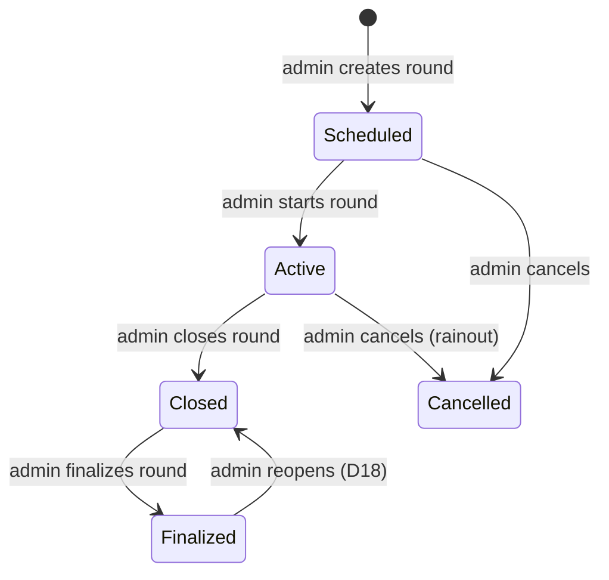

# AG Golf League Management Software — Design Document

## 1. Overview
This golf league management software will manage a public 9-hole golf league. The league plays at an 18-hole course; each round, a group plays either the front nine (holes 1–9) or the back nine (holes 10–18), alternating week to week.

### 1.1 Scope and phases
- **Phase 1 (MVP):** courses/tees/holes, games, leagues, registration, members and flights, tee times, groups, rounds (start/close/finalize), special event rounds at other courses, game voting, online hole-by-hole scoring, admin score entry/edit, payouts and skins, handicap calculation, league home page, round detail page, member page, notifications (web + email), shared member login with member ID, individual admin login/reset, full history retention.
- **Phase 2:** scorecard picture upload by players, member-to-member messaging, season standings/reports.
- **Phase 3 / maybe:** score submission by email (requires inbound email parsing), tee time import from the course.
- **Out of scope:** online payment collection, official GHIN handicap posting, more than one course within a single round.

Items marked **D#** refer to the Open Decisions log in section 11. Where a proposed default is given, it is used until the decision is confirmed.

## 2. What I want to be able to do, store and provide

### 2.1 Courses
- As admin, I want to be able to create/update/remove a golf course: name, address, phone, website, notes.
  - As admin, I want to be able to store golf course pictures, including a scorecard picture.
  - As admin, under the golf course I want to be able to create/update tees (color/name, plus Course Rating and Slope Rating for the front nine and for the back nine). Ratings are required for handicap calculation.
  - As admin, under the golf course I want to be able to create/update holes 1 to 18 with par, hole handicap (stroke index), and yardage for each tee.

### 2.2 Games
- As admin, I want to be able to create/update/remove golf games. Each game has a name, description, game type (which selects the scoring function), team/individual flag, "counts toward handicap" flag, handicap percentage, whether flights are used, whether skins are active, and the payout table used.

### 2.3 Leagues, members and registration
- As admin, I want to be able to create a league, storing the name, start and end dates, default entry fee, and the home golf course the members normally play at.
  - Regular rounds are played at the home course. Special event rounds can be played at a different course (section 2.9).
  - A member record is global and carries over between leagues (seasons). Existing members join a new league by re-registering, which creates a new league membership for them.
- As a user, I want to be able to register for the league, which either creates a member record or updates an existing member record and creates the league membership. A new member is shown (and emailed) their member ID when registration completes; a returning member keeps their existing ID. (Approval / email verification: **D1**.)
- As admin, I want to be able to create/update/remove members (players). I can create multiple admins as well. Admins are players with extra abilities to manage the league.
- Members are assigned a flight (1, 2, or 3) based on their handicap:
  - Flight 1: handicap 5.0 and lower
  - Flight 2: handicap 5.1 to 10.0
  - Flight 3: handicap above 10.0
  - Flights will be adjusted so there are at least 15 players in a flight where possible. The exact balancing rule and when flights are recalculated are **D2**.

### 2.4 Tee times and groups
- As admin, once the league is created, I want to be able to create/update a list of tee times for the front nine and a list for the back nine. These lists form the league's default tee time set, used by regular rounds.
- As admin, I want to be able to create additional tee time sets (for example, for a special event at another course) and assign one to a specific round instead of the default.
- As admin, I need the ability to easily adjust tee times, for example by applying an offset to all of them to account for daylight availability.
- As admin, I want to be able to create/update/remove groups. Groups line up with tee times and define which members play together and when. Groups do not always define teams.
- As admin, for each round I need to be able to switch groups to the opposite nine. Groups play the front nine one week and the back nine the next.
- How players get into a round and into groups (sign-up, group size, manual vs. automatic assignment) is **D3**.

### 2.5 Rounds
- As admin, once the league is created, I want to be able to create rounds. There is one round for each day the league plays. A round defines the date, the course (defaults to the league's home course), the tee time set (defaults to the league's default set), the game to be played (or the games players can vote on, section 2.10), and the entry fee per player (defaults to the league entry fee, $10).
- As admin, I need to be able to start a round so it is active. Starting a round creates a score record for every player in the round with all hole scores empty (not yet entered). Empty is stored as NULL, never 0.
- As admin, I need to be able to close a round, which disables online scoring.
  - I need to be able to view/edit scores.
  - For team games, I need to be able to adjust team members after the round is complete and before scoring computation begins.
- As admin, I need to be able to finalize a closed round, which:
  - Calculates scores based on the game's scoring rules
  - Applies handicaps as defined by the game's scoring rules
  - Determines placement (1, 2, 3, etc.) using the tie rules in section 2.8
  - Determines skins, if skins are active
  - Updates score records with placement and winnings
  - Updates player handicaps, if the game counts toward handicap
- See section 5 for the full round lifecycle.

### 2.6 Notifications and messages
- As admin, I want to be able to create/update/remove notifications, which are shown on the league main web page and emailed to all members.
- As a user, I want to be able to send other users messages and read messages sent to me. (Phase 2)

### 2.7 Player and guest pages
- As a guest (non-member), I want to be able to view the league main web page. Guests never see member email addresses or phone numbers.
- As a user, I log in with the league's shared login ID and password, then enter my unique member ID number to access my own data or enter my score (section 9). I can switch to a different member ID without logging out, for example when entering scores for my group.
- As a user, I want to be able to go to the league home web page and see information about the league, including notifications and a list of rounds with the status of each.
- As a user, I want to be able to go to a detail web page for a round and view its details, scoring if it has been played, placements and winnings.
- As a user, for the active round, I want to be able to enter my score online. Scoring is always hole by hole, for every hole played. The score entry page must work well on a phone. (Who may enter or edit whose score: **D4**.)
- As a user, I want to be able to submit a scorecard picture if I do not use online scoring. An admin then enters the scores. (Phase 2)
- As a user, I want to be able to submit my round scores via email. (Phase 3; format and parsing: **D5**.)
- As a user, I want to be able to go to my own member web page, where I can view the rounds I played in, my placement and winnings for each, and my total winnings.

### 2.8 Payouts, ties and money
- Each player pays the round entry fee (default $10) into the pot. Whether payment is tracked in the software is **D6**.
- All money is stored as integer cents. Rounding rules and where leftover cents go are **D7**.
- **Flight games (individual stroke scoring):** the pot is divided among flights. The share for each flight comes from an admin-editable flight table and depends on the number of players in each flight. Proposed default: each flight's share is proportional to its player count (**D8**).
- Within each flight, places 1 to 15 are paid from the flight pot using the admin-editable placement table below (the percentages add up to 100%):

  | Place | % | Place | % | Place | % |
  |---|---|---|---|---|---|
  | 1 | 11.0 | 6 | 8.5 | 11 | 6.0 |
  | 2 | 10.5 | 7 | 8.0 | 12 | 3.0 |
  | 3 | 10.0 | 8 | 7.5 | 13 | 2.0 |
  | 4 | 9.5 | 9 | 7.0 | 14 | 1.0 |
  | 5 | 9.0 | 10 | 6.5 | 15 | 0.5 |

- What happens when a flight has fewer than 15 players (rescale vs. return unpaid percentages to the pot) is **D9**.
- Ties in placement: proposed default is that tied players split the combined percentages of the places they occupy (**D10**).
- **Skins** (when active): $5 per hole ($45 for nine holes) is taken out of each flight pot before placement payouts and paid as skins.
  - Within the flight, a skin is won by the single lowest gross score on a hole.
  - If the hole is tied, the skin carries over and is added to the next hole. It can carry over multiple holes, so the 9th hole skin could be worth $45.
  - A skin not won by the end of nine holes returns to the flight pot and is paid out by placement.
  - Whether the $45 is fixed regardless of flight size is **D11**.
- **Team games (e.g. scramble):** there are no flights. The whole pot is paid to teams by placement using an admin-editable team payout table. Each team's winnings are divided evenly among its members.

### 2.9 Special events
- As admin, I want to be able to create a special event round, where the league plays a course other than its home course. A special event round has an event name, its course, and its own tee time set.
- The course must be set up like any other course (tees, ratings, holes, yardages) so scoring and handicaps work.
- Which holes are played at a special event (front nine, back nine, a 9-hole course, or 18 holes) is chosen on the round. The front/back alternation of groups does not apply to special event rounds, and a special event does not change the alternation for the next regular round.
- Whether special events count toward handicap and use the normal flight payouts is **D26**.

### 2.10 Game voting
- As admin, for each round I want to be able to choose a list of candidate games, and set when voting opens and closes.
- As a member, I want to be able to log in and vote for the game I would like to play in an upcoming round. One vote per member per round; I can change my vote until voting closes.
- As a member, I want to see the current vote counts for a round (visibility before close: **D28**).
- When voting closes, the game with the most votes becomes the round's game. Ties and whether the admin can override the result are **D27**.
- Voting must be closed and the round's game set before the round can be started.
- Who may vote (all league members, or only players signed up for that round) is **D29**.

### 2.11 Historical data
- All league data is kept for historical purposes, including leagues, rounds, games, courses, players, groups, teams, scores, placements, payouts, skins, handicap history and votes.
- "Remove" in this document means **archive**: the record is hidden from lists and can't be chosen for new rounds, but it stays in the database and still appears in historical pages. League data is never hard-deleted from the application.
- Results must not change when reference data changes later. When a round is finalized, the values used to compute it (course rating, slope, par, hole handicaps, handicap index, handicap percentage, payout percentages, entry fee) are stored with the round's scores and payouts, so editing a course, game or payout table only affects future rounds.
- Players can view past leagues (seasons) and their results.

## 3. Game definitions
- Some game types apply a percentage of the player's handicap. The game specifies the percentage.
- Some team game types average the team members' handicaps and apply a percentage of that average as the team handicap. The game specifies the percentage.
- Each game references a payout table, so games define how winnings are split by placement.
- Because scoring rules are complex, each game type maps to a scoring function in code. Finalizing a round calls that function to process each score, apply handicaps and calculate placement.
- Net score = total gross score for the nine minus the applied handicap, unless the game says otherwise. Whether handicap strokes are applied to the total or allocated hole by hole is **D12**.

Games to be supported:

| Game | Scoring | Handicap applied | Counts toward handicap | Payout |
|---|---|---|---|---|
| Stroke play | Individual, per hole | 100% of player handicap | Yes | By flight, by place |
| Stroke play with skins | Individual, per hole | 100% of player handicap | Yes | By flight, by place, plus skins |
| Scramble | One team score per hole | % of averaged team handicap | No | Team payout table, no flights |
| Modified best ball | Individual, per hole | % of player handicap | No | By flight, by place |
| Red, white, blue | Individual, per hole; tee recorded per hole | % of player handicap | No | By flight, by place |
| Modified red, white, blue | Individual, per hole; tee recorded per hole | % of player handicap | No | By flight, by place |
| Irons only | Individual, per hole | 100% of player handicap | No | By flight, by place |
| 3 clubs only | Individual, per hole | 100% of player handicap | No | By flight, by place |
| Tick, tack, toe | Individual, per hole, plus tick/tack/toe flags | 100% of player handicap | Yes | By flight, by place (tick/tack/toe value: **D13**) |

- **Stroke play:** standard stroke play. Placement is by net score. The number of paid places depends on the number of players, typically 15.
- **Stroke play with skins:** standard stroke play, with skins played on each hole (see section 2.8).
- **Scramble:** team based. Each player hits, all players move to the best ball and hit again, continuing until holed out.
  - Team formation: by default, the team is the group you teed off with. Admin can adjust teams after the round (section 2.5).
  - Scoring: one score per hole is stored for the team. Any team member may enter it; all members see the same score.
  - Team size rules: **D14**.
- **Modified best ball:** standard stroke play, except each player may move their ball to the best ball once per hole. The rest of the hole is played individually until holed out.
- **Red, white, blue:** players choose to hit from the red, white or blue tees on holes of their choice, and must play exactly 3 holes from each. The score page records the tee played on each hole and enforces 3/3/3.
- **Modified red, white, blue:** players start on their normal tee color. After a bogey (or worse — **D15**), the player moves forward one tee; after a par they stay on the same tee; after a birdie or better they move back one tee. If already on the front or back tee, they stay there. The tee played is recorded per hole.
- **Irons only:** the entire round is played with irons only.
- **3 clubs only:** each player chooses three clubs and uses only those clubs for the entire round.
- **Tick, tack, toe:** standard stroke play, but players also record, per hole: first on the green (tick), closest to the pin (tack), and first in the hole (toe), on the scoring page or scorecard.

## 4. Technology & Hosting
- **Language/Framework:** PHP 8.2+ / CodeIgniter 4.x
- **Database:** SQLite in WAL mode. This is sufficient for the expected load (section 7). Revisit only if write contention appears.
- **Front end:** server-rendered pages, mobile-first layout (score entry happens on the course on phones).
- **Hosting Environment:** self-hosted on a home Linux PC.
- **Network and SSL (D16):** proposed: Cloudflare Tunnel (no port forwarding or dynamic DNS needed, SSL handled). Alternative: dynamic DNS + port forwarding + reverse proxy (Caddy or nginx) + Let's Encrypt.
- **Email (D17):** outgoing email must go through a transactional email service (e.g. Postmark, Mailgun, Amazon SES, SMTP2GO). Residential ISPs commonly block port 25, and mail sent directly from a home IP is usually marked as spam.
- **File storage:** uploaded pictures are stored on disk outside the web root, with file-type checks and a size limit (proposed 10 MB).
- **Constraints:** _hardware specs, domain name_

## 5. Round Lifecycle

| State | Meaning | Who can change scores | Shown to players as |
|---|---|---|---|
| Scheduled | Round created; date, course, tee time set and entry fee set; game voting may be open; groups/tee times being arranged | Nobody (no score records yet) | Upcoming (voting open/closed) |
| Active | Round is being played | Players (per D4) and admins | In progress |
| Closed | Online scoring disabled; admin reviews scores and adjusts teams | Admins only | Scoring in review |
| Finalized | Results computed; placements, winnings and handicaps recorded | Nobody (reopen first) | Final |
| Cancelled | Round not played or abandoned (e.g. rainout) | Nobody | Cancelled |

| Transition | Preconditions | Side effects |
|---|---|---|
| Scheduled → Active | Voting (if used) is closed; game, course, entry fee and groups are set | Create one score record per player (or per team) with NULL hole scores; set front/back nine per group (regular rounds) or the event's holes (special events) |
| Active → Closed | — | Disable online score entry |
| Closed → Finalized | Every score record is complete, or admin marks missing players as no-show (D19) | Run the game's scoring function; compute placement, ties, skins, payouts; store the course, handicap and payout values used (section 2.11); update handicaps if the game counts toward handicap; record who finalized and when |
| Finalized → Closed | Admin confirms | Delete computed payouts/placements; reverse handicap updates from this round (D18) |
| → Cancelled | Admin confirms | No payouts; entry fee handling per D20 |

## 6. Data Model (proposed)
All tables also have `id`, `created_at` and `updated_at`. Money is stored in integer cents. Handicaps are stored to one decimal place. Reference tables (course, tee, game, payout_table, member, league) also have `archived_at`; they are archived, never deleted (section 2.11).

### Courses
- **course** — name, address, phone, website, notes. Any course can be a league's home course or a special event course.
- **course_photo** — course_id, file_path, caption, is_scorecard
- **tee** — course_id, name/color, sort_order (front to back), front9_course_rating, front9_slope, back9_course_rating, back9_slope
- **hole** — course_id, number (1–18), par, handicap_index (stroke index)
- **hole_yardage** — hole_id, tee_id, yards

### Members and leagues
- **member** — member_number (unique ID entered after the shared login, D25), first_name, last_name, email, phone, is_admin, admin_email (unique, admins only), admin_password_hash (admins only), default_tee_id, handicap_index, handicap_override (nullable), status (active/inactive)
- **league** — name, home_course_id, default_tee_time_set_id, start_date, end_date, default_entry_fee_cents, shared_login_id, shared_password_hash
- **league_membership** — league_id, member_id, flight (1/2/3), registered_at; unique (league_id, member_id)
- **password_reset** — member_id (admins only), token_hash, expires_at, used_at

### Games and payouts
- **game** — name, description, game_type (selects the scoring function), is_team_game, uses_flights, skins_enabled, skin_amount_cents, handicap_percent, counts_toward_handicap, payout_table_id
- **payout_table** — name (e.g. "Individual by place", "Team")
- **payout_table_row** — payout_table_id, place, percent
- **flight_payout_config** — league_id, flight, percent (or rule per D8)

### Tee times, rounds, groups and teams
- **tee_time_set** — league_id, name (e.g. "Regular", "Fall Classic at Pine Hills"), course_id
- **tee_time** — tee_time_set_id, nine (front/back/all), base_time, sort_order
- **round** — league_id, course_id, tee_time_set_id, game_id (nullable until voting closes), is_special_event, event_name, holes_played (front/back/all — set for special events; regular rounds use the group's nine), play_date, entry_fee_cents, tee_time_offset_minutes, voting_opens_at, voting_closes_at, status (scheduled/active/closed/finalized/cancelled), finalized_at, finalized_by
- **round_game_option** — round_id, game_id (candidate games for voting)
- **game_vote** — round_id, member_id, game_id, voted_at; unique (round_id, member_id)
- **round_group** — round_id, tee_time_id, nine (front/back), group_number
- **round_group_member** — round_group_id, member_id
- **team** — round_id, name, handicap_applied
- **team_member** — team_id, member_id

### Scoring and results
- **score** — round_id, member_id (nullable for team score), team_id (nullable), flight (copied at start of round), tee_id, course_rating_used, slope_used, par_used, handicap_index_used, handicap_percent_used, course_handicap, handicap_applied, gross_total, net_total, place, winnings_cents, status (in_progress/complete/no_show)
- **hole_score** — score_id, hole_id, par_used, hole_handicap_used, strokes (NULL until entered), tee_id (for red/white/blue games), tick, tack, toe (flags), entered_by_member_id, entered_at
- **round_payout_snapshot** — round_id, flight (nullable for team games), pot_cents, place, percent_used, amount_cents (the payout table as it was applied at finalization)
- **scorecard_image** — score_id, file_path, uploaded_by, uploaded_at
- **skin_result** — round_id, flight, hole_id, winner_member_id (nullable), amount_cents, carried_over
- **handicap_history** — member_id, round_id (nullable), score_differential, handicap_index_before, handicap_index_after, source (calculated/admin override), changed_by

### Communication and audit
- **notification** — league_id, title, body, published_at, emailed_at, created_by
- **message** — from_member_id, to_member_id, subject, body, sent_at, read_at
- **audit_log** — member_id (who: the admin, or the member ID entered after shared login), session_id, ip_address, action, entity_type, entity_id, before_json, after_json, created_at. Every score entry and every admin change to scores, teams, handicaps, votes and round status is logged.

## 7. Handicap Calculation
- Use the World Handicap System (WHS) method for 9-hole scores. 9-hole scores are converted to an 18-hole score differential using the WHS expected-score method.
- Course handicap for a nine: `Handicap Index ÷ 2 × (Slope ÷ 113) + (Course Rating − Par)`, using the rating, slope and par for the nine and tee played.
- One handicap index per player. Front-nine and back-nine differences are handled automatically by the separate ratings for each nine, so no separate front/back handicaps are kept.
- Apply WHS adjustments, including net double bogey as the maximum hole score for handicap purposes.
- Handicaps are updated automatically when a round is finalized, using only games marked "counts toward handicap".
- Admin can enter or override a player's handicap. Overrides are recorded in handicap history.
- This is a league-only handicap, not an official GHIN handicap.
- **Still to decide:** starting handicap for new players (D21); number of scores required before a handicap is established, and how many recent scores are used (D22); rounding rules (D23).

## 8. Performance / Hardware Constraints
- Expected concurrent users: 100 maximum.
- Peak load is during and right after a round, when players are entering scores on their phones.

## 9. Security & Access Control
- **Member login (shared):** all members log in with one shared login ID and password for the league. After logging in, the member enters their unique member ID number, which selects whose data they see, whose score they enter, and whose vote they cast. The member ID can be changed during the session (e.g. to enter scores for others in the group).
  - Admin sets and changes the shared login ID and password (at least 8 characters, stored with PHP `password_hash()`). Proposed: change it each season.
  - There is no per-member password reset; a forgotten shared password is re-sent by an admin or posted where members can see it.
- **Known risk of the shared login:** anyone who has the shared password and knows (or guesses) another member's ID can view that member's data, enter their score or cast their vote. Mitigations:
  - Member IDs are not sequential and not easy to guess (D25).
  - Rate-limit member ID entry (e.g. lock the session after 5 wrong IDs).
  - Every score entry and vote records the member ID used, session and IP address in the audit log, and admins can review and correct scores while the round is Closed.
  - Member contact details (email, phone) are shown only to admins.
- **Admin login (individual):** each admin has their own email and password (at least 8 characters, `password_hash()`), separate from the shared login. Admin passwords can be reset through an emailed, single-use link that expires (proposed: 1 hour). Admin pages are never reachable through the shared login.
- Roles: guest, member (shared login + member ID), admin. Admin pages and actions check the admin role on every request.
- CSRF protection on all forms (CodeIgniter built-in). Rate limiting on login and password reset.
- SSL must be in place so browsers do not show an insecure-website warning.
- Uploads are validated by file type and size, and served through the application, not directly from the upload folder.
- Guests never see member contact information.

## 10. Data Backup & Retention
- Backups run daily to a remote drive or cloud drive.
- Back up both the SQLite database (using SQLite's online backup, not a plain file copy while in use) and the uploaded pictures folder.
- Test a restore at least once before the season starts.
- All league data is kept indefinitely for historical purposes (section 2.11). There is no purge feature in the application.

## 11. Open Decisions Log
| # | Question | Proposed default | Status |
|---|---|---|---|
| D1 | Is registration open, or does an admin approve it? Is email verification required? | Open registration with email verification; admin can deactivate | Open |
| D2 | Flight balancing rule and when flights are recalculated | Sort by handicap; use the cutoffs, then move boundary players so each flight has ≥15 when there are ≥45 players; recalculate before each round starts, then freeze for that round | Open |
| D3 | How players sign up for a round; group size; manual vs. automatic group assignment | Players mark "playing" for each round before it starts; groups of 4; admin assigns, with an auto-fill option | Open |
| D4 | Who can enter/edit a score during an active round? | Player enters their own; anyone in the same group can enter for the group; admins can edit any | Open |
| D5 | Email score submission format | Phase 3; defer | Open |
| D6 | Is entry fee payment tracked in the software? | Admin checkbox "paid" per player per round | Open |
| D7 | Money rounding | Round payouts down to whole dollars; leftover goes to the 1st place payout in that flight | Open |
| D8 | Formula for dividing the pot among flights | Proportional to number of players in each flight | Open |
| D9 | Flight with fewer than 15 players | Pay only the places that exist and rescale the percentages to 100% | Open |
| D10 | Tie handling for placement | Tied players split the combined percentages of the places they occupy | Open |
| D11 | Is the $45 skins amount fixed regardless of flight size? | Fixed $5 per hole, admin-editable on the game | Open |
| D12 | Handicap applied to the total vs. allocated hole by hole | Applied to the total for placement; hole allocation used only for net double bogey | Open |
| D13 | What a tick, tack or toe is worth and how it affects payout | — | Open |
| D14 | Scramble team size and handling of uneven teams | Teams of 2–4; team handicap percentage set on the game | Open |
| D15 | Modified RWB: does "bogey" mean bogey or worse? | Bogey or worse | Open |
| D16 | Network/SSL approach | Cloudflare Tunnel | Open |
| D17 | Transactional email provider | — | Open |
| D18 | Can a finalized round be reopened? | Yes, admin only; reverses payouts and handicap updates from that round | Open |
| D19 | Missing scores at finalization | Admin marks the player as no-show; no-shows are excluded from placement and the pot | Open |
| D20 | Entry fees for a cancelled round | Not collected / refunded | Open |
| D21 | Starting handicap for a new player | Admin enters it at registration | Open |
| D22 | Scores required to establish a handicap, and how many recent scores are used | Per WHS: best 8 of the last 20 18-hole differentials | Open |
| D23 | Handicap rounding | Per WHS | Open |
| D24 | How do we coordinate with and get tee times from the golf course? | Admin enters them manually | Open |
| D25 | Member ID format and how it's assigned | Random, non-sequential 5-digit number assigned at first registration and kept across seasons; admin can regenerate it | Open |
| D26 | Do special event rounds count toward handicap and use the normal flight payouts? | Same as any round: follows the game's settings | Open |
| D27 | Voting ties, and can the admin override the voting result? | Admin breaks ties and may override; the override is logged | Open |
| D28 | Can members see vote counts before voting closes? | Yes, live counts | Open |
| D29 | Who may vote on a round's game? | All active members of the league | Open |

## 12. Glossary
- **League:** one season of play at one course.
- **Round:** one day of league play, with one game.
- **Special event:** a round played at a course other than the league's home course, with its own tee time set.
- **Tee time set:** a named list of tee times. The league has a default set; a round can use a different one.
- **Member ID:** a member's unique ID number, entered after the shared login to identify who is using the site.
- **Archive:** hide a record from current use while keeping it for history. League data is archived, never deleted.
- **Group:** players who tee off together at one tee time.
- **Team:** players whose scores are combined for a team game. Often the same as a group, but not always.
- **Flight:** a handicap band (1, 2 or 3) used to divide the pot in individual games.
- **Pot:** total entry fees collected for a round.
- **Skin:** money won by having the single lowest gross score on a hole within a flight.
- **Handicap index:** a player's portable handicap. **Course handicap:** the strokes a player gets for a specific nine and tee.
